# Lotería Push

## screenshots

### Ronda 2. La baraja
**Rojo**

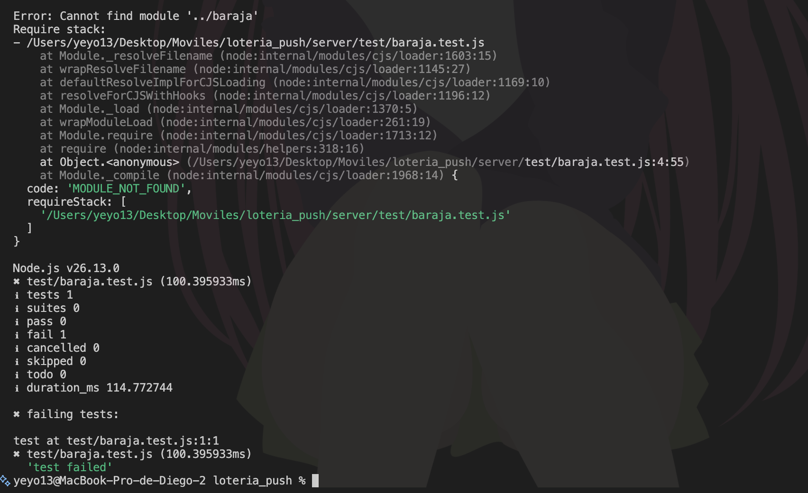

**Verde**

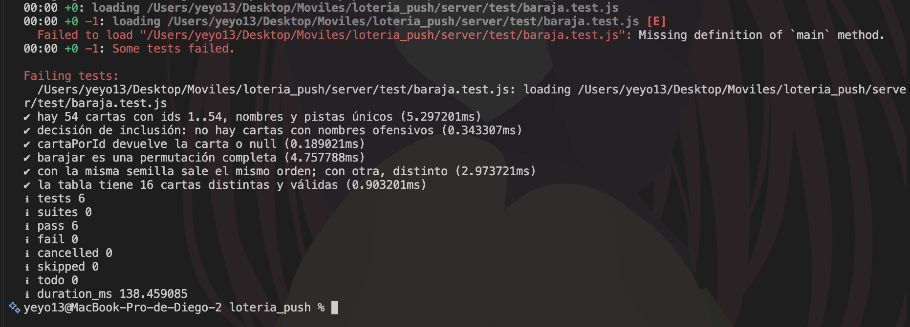

### Ronda 3. Líneas ganadoras
**Rojo**

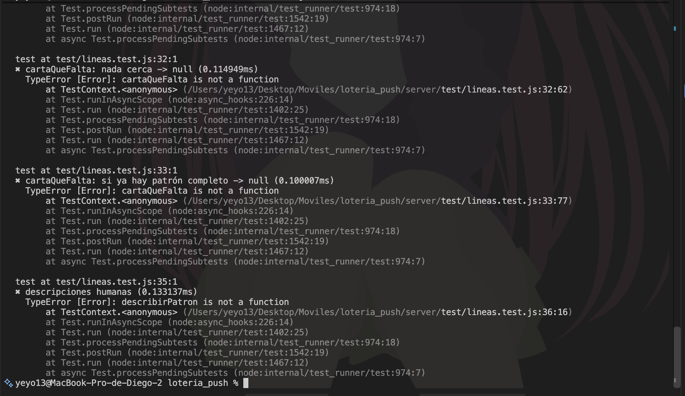

**Verde**

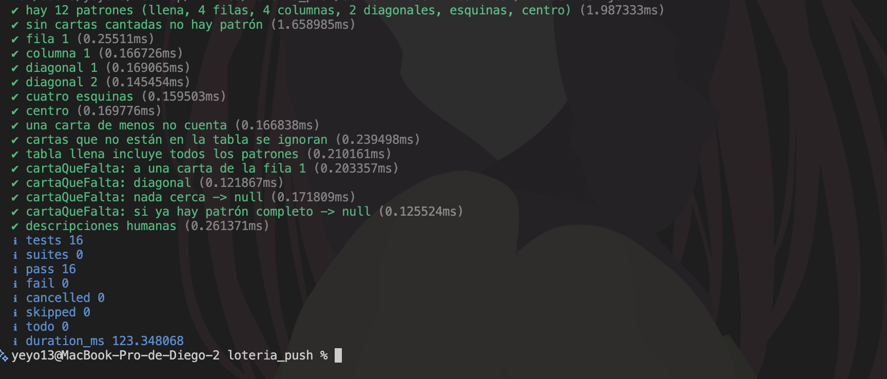

### Ronda 4. Mensajes push
**Rojo**

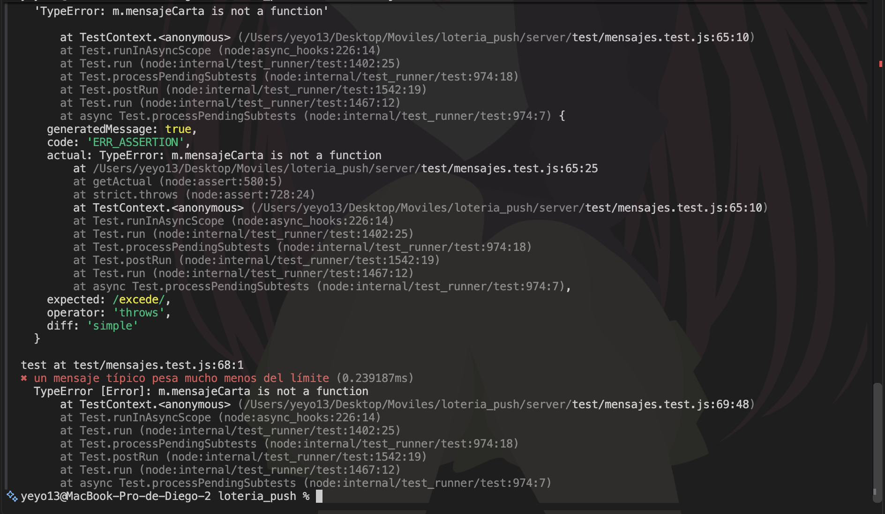

**Verde**

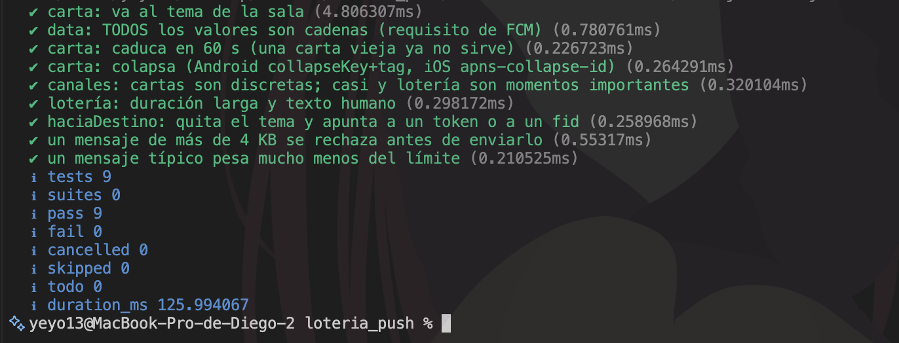

### Ronda 5. La sala y reglas
**Rojo**

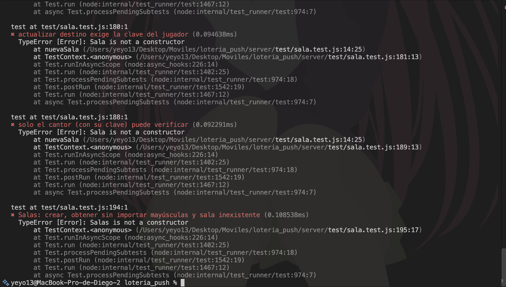

**Verde**

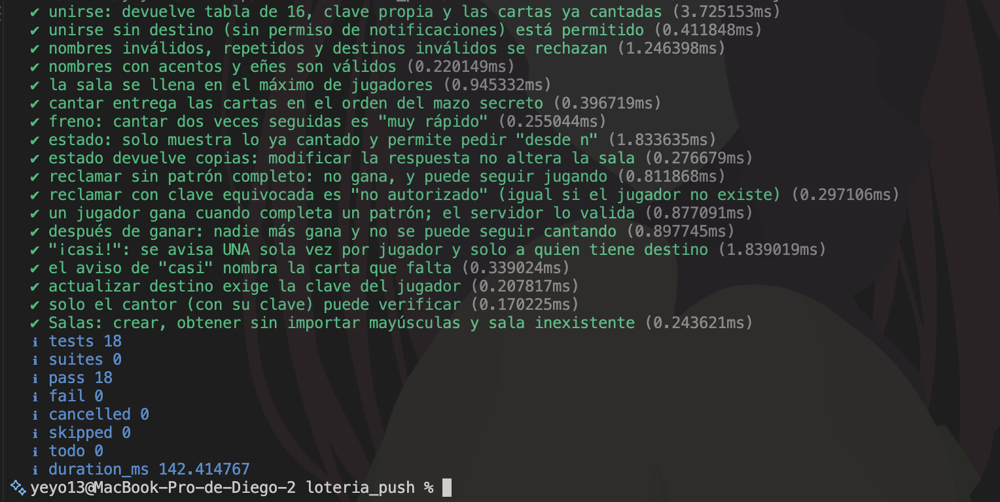

### Ronda 6. Servidor HTTP y envío seguro
**Rojo**

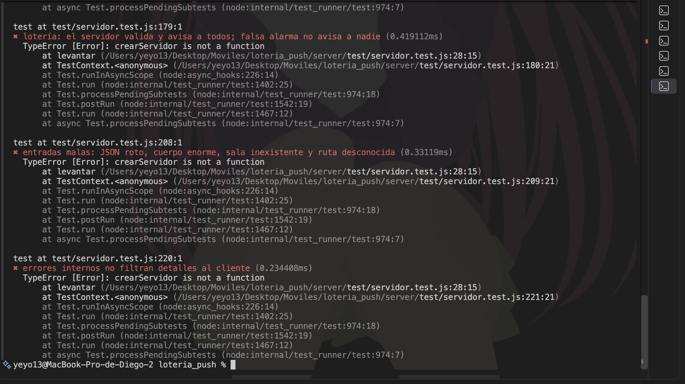

**Verde**

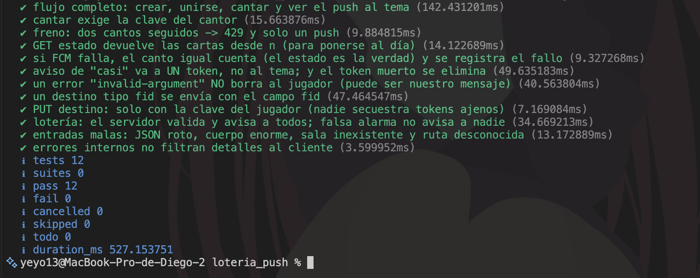

### Ronda 7. Eventos y parseo
**Rojo**

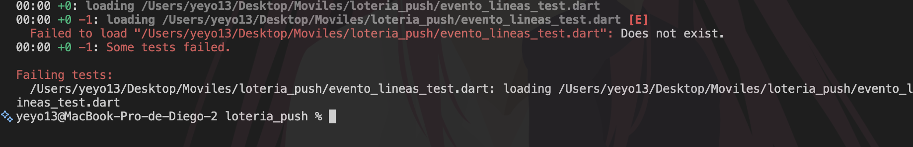

**Verde**

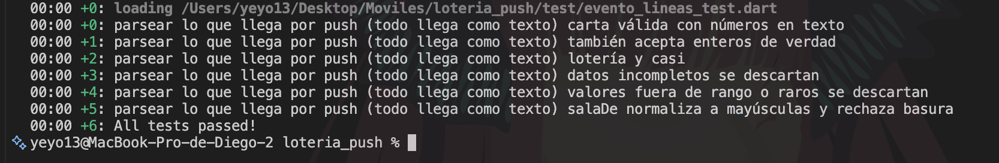

### Ronda 8. La partida y huecos
**Rojo**

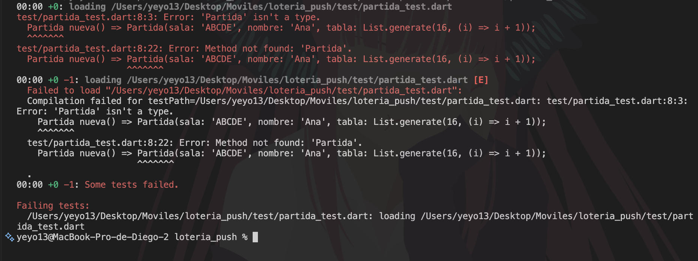

**Verde**

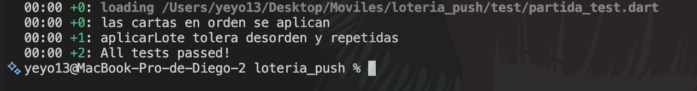

### Ronda 9. El controlador
**Rojo**

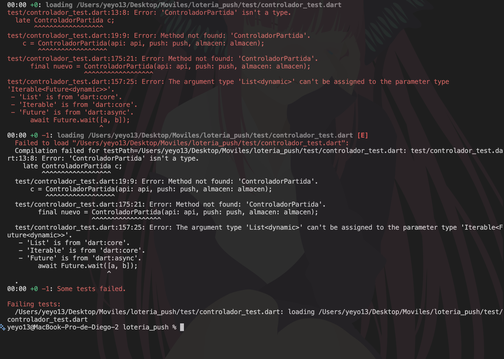

**Verde**

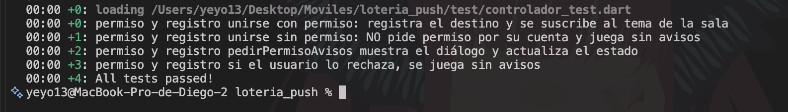

### Ronda 11. Pantallas y ViewModels
**Rojo**

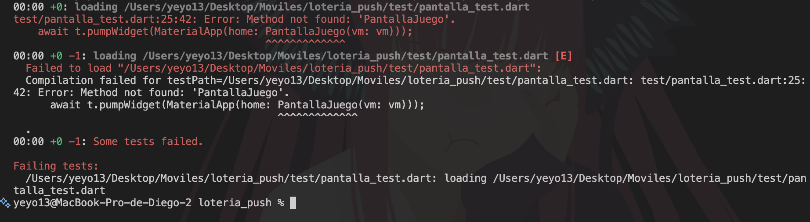

**Verde**

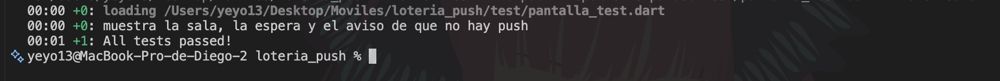

### Captura final
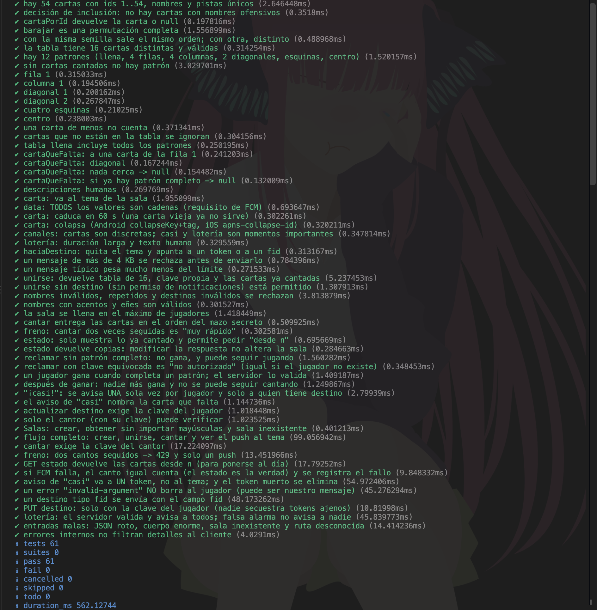

### Captura de funcionamiento

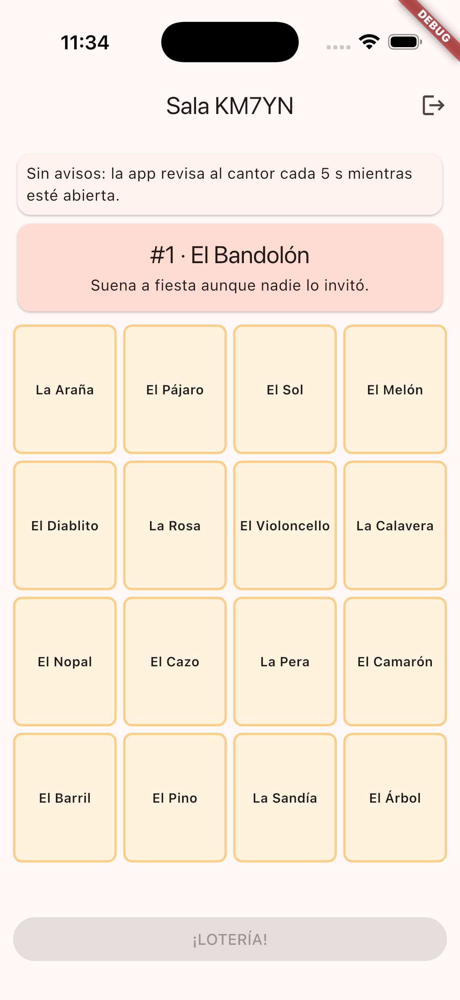

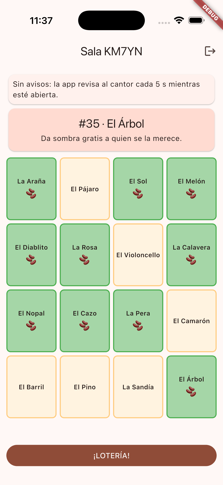
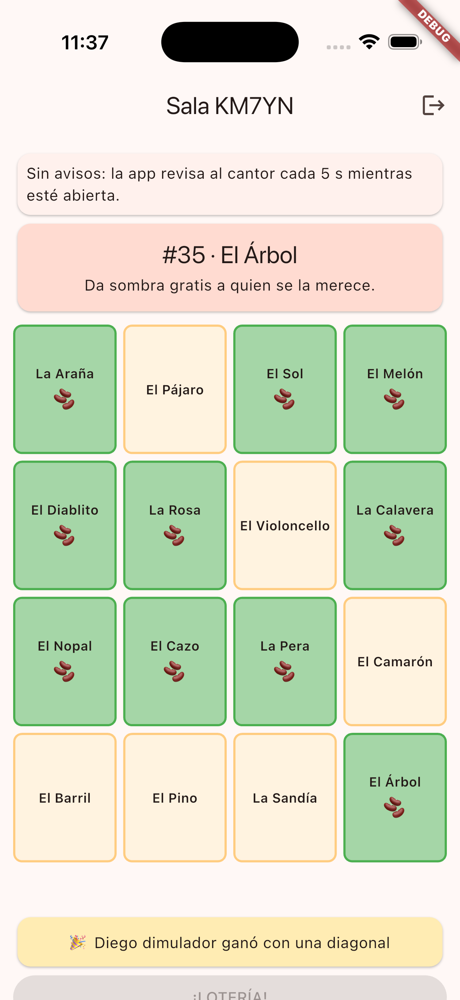